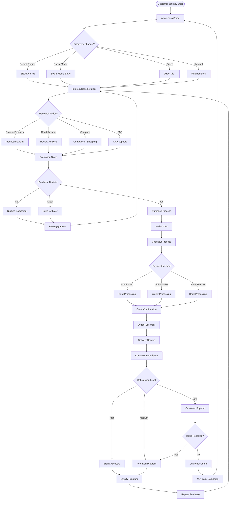
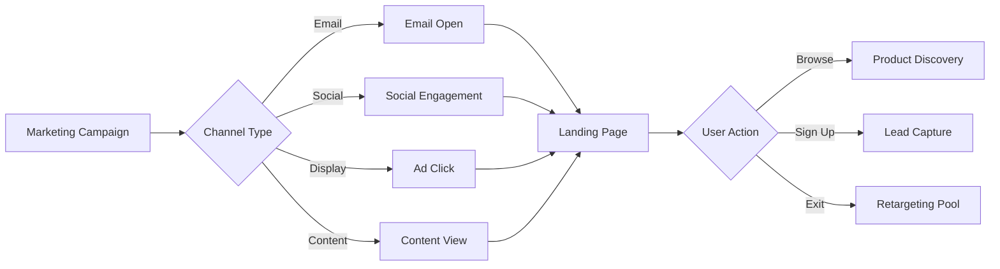
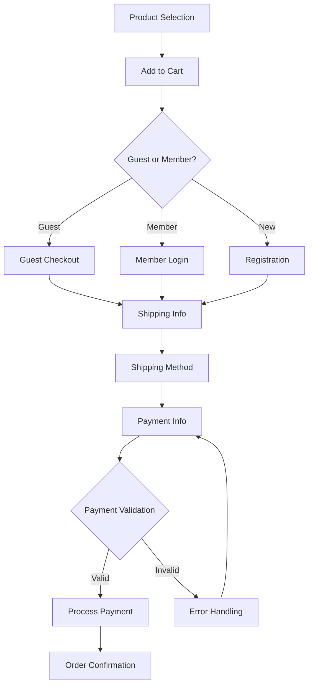
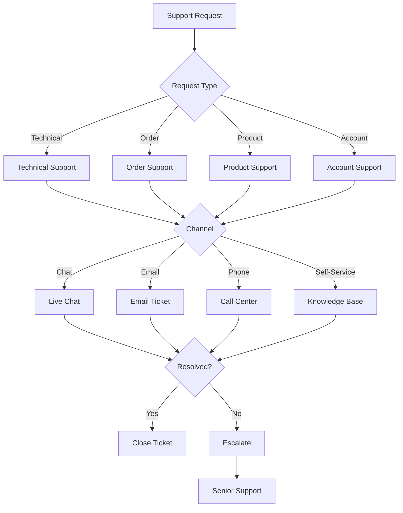
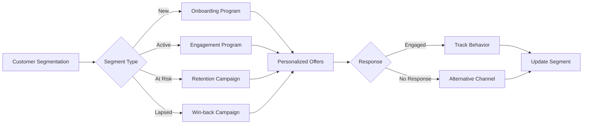
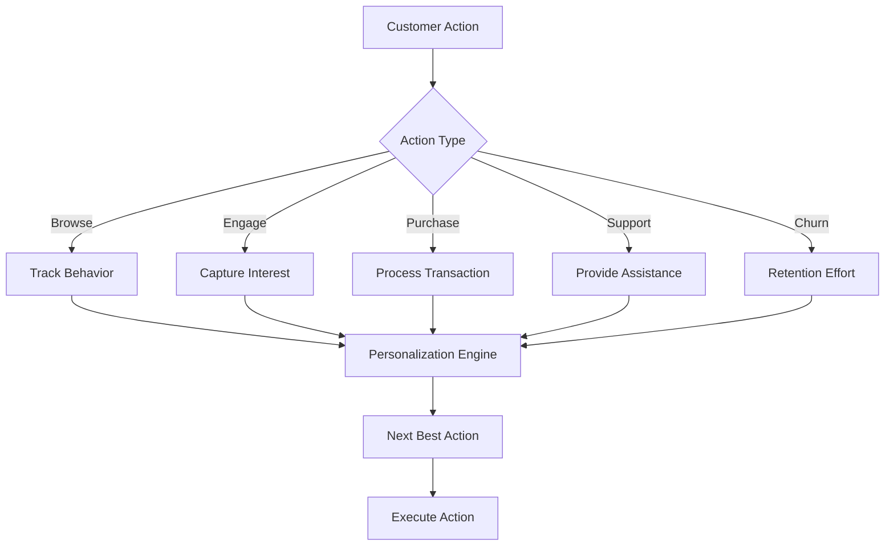
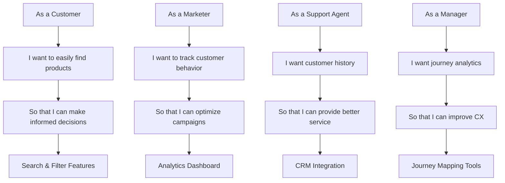
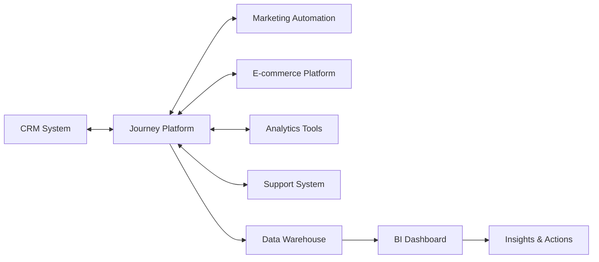
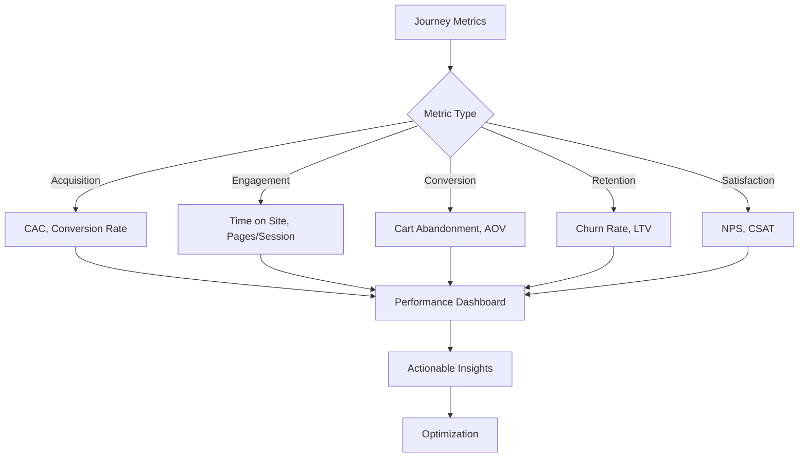

# Customer Journey Management Flow Diagram

## Main Customer Journey Flow

## Detailed Sub-Flows

### 1. Awareness Stage Flow

### 2. Purchase Process Flow

### 3. Customer Support Flow

### 4. Retention & Loyalty Flow

## Key Decision Points

### Customer Journey Decision Matrix

## User Story Implementation Flow

### Epic: Customer Journey Management

## Integration Points

## Metrics & KPIs Flow

