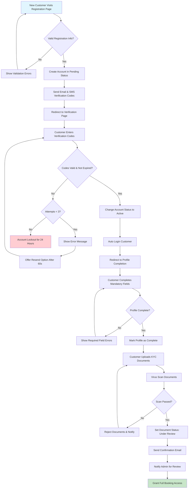
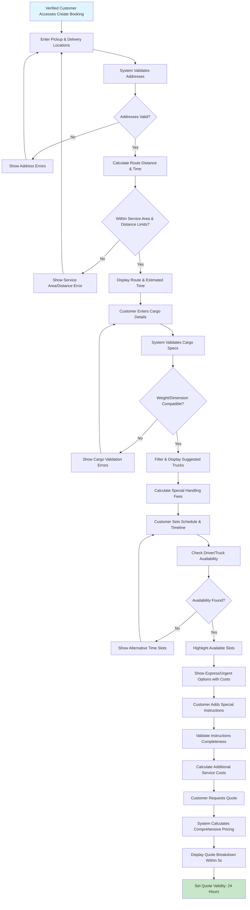
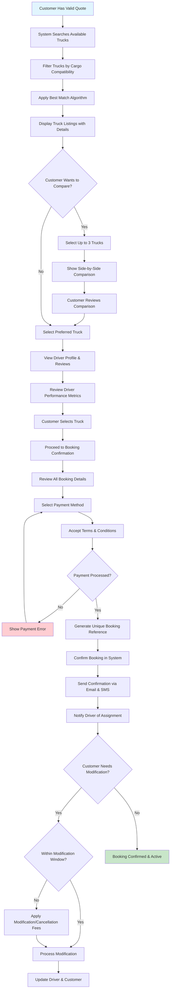
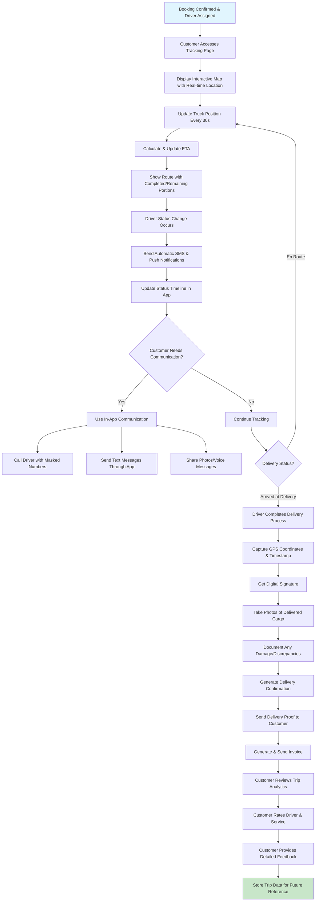
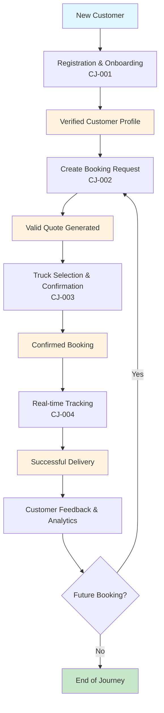

# Customer Journey Management System - Flow Diagrams

This document contains detailed flow diagrams for all user stories in the Customer Journey Management system.

## Story CJ-001: Customer Registration and Onboarding Flow

## Story CJ-002: Advanced Booking Request Creation Flow

## Story CJ-003: Smart Truck Selection and Booking Confirmation Flow

## Story CJ-004: Real-time Shipment Tracking Flow

## Master Customer Journey Flow

## Key Process States and Business Rules

### Registration Process States
- **Pending**: Account created, awaiting verification
- **Active**: Email/SMS verified, can complete profile
- **Complete**: Profile completed, KYC uploaded
- **Approved**: Admin approved, full access granted
- **Locked**: Too many failed verification attempts

### Booking Process States
- **Draft**: Booking being created
- **Quoted**: Quote generated and valid
- **Confirmed**: Payment processed, booking confirmed
- **Assigned**: Driver assigned to booking
- **In Transit**: Cargo picked up and en route
- **Delivered**: Cargo successfully delivered
- **Completed**: Customer feedback received

### Key Business Rules
1. **Service Area Validation**: Both pickup and delivery must be within service areas
2. **Distance Limits**: 1km minimum, 1000km maximum per booking
3. **Weight Limits**: 1kg to 50,000kg capacity
4. **Dimension Limits**: Max 15m x 3m x 4m
5. **Advance Booking**: Minimum 2 hours for standard service
6. **Modification Windows**: Free changes up to 24 hours before pickup
7. **Cancellation Fees**: Graduated fees based on timing (25% within 24hrs, 50% within 2hrs)

### Performance Requirements
- Quote generation: Within 5 seconds
- GPS tracking updates: Every 30 seconds
- Document upload: Complete within 30 seconds
- Virus scanning: Complete within 5 seconds
- Map updates: Real-time with 30-second refresh