# Detailed Acceptance Criteria Flow Diagrams

This document contains granular flow diagrams for each acceptance criteria within the user stories.

## CJ-001: Customer Registration and Onboarding

### AC-001: Account Creation Flow

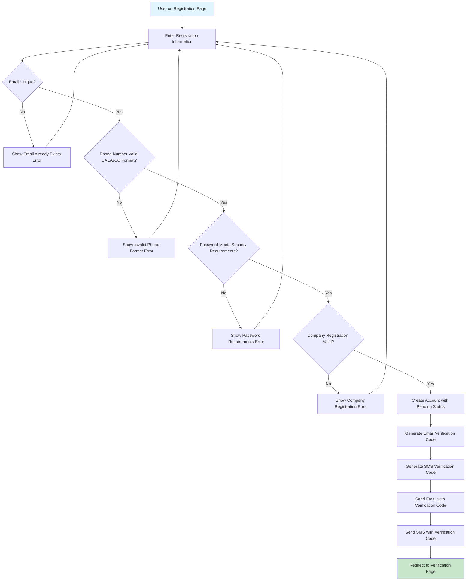

### AC-002: Account Verification Flow

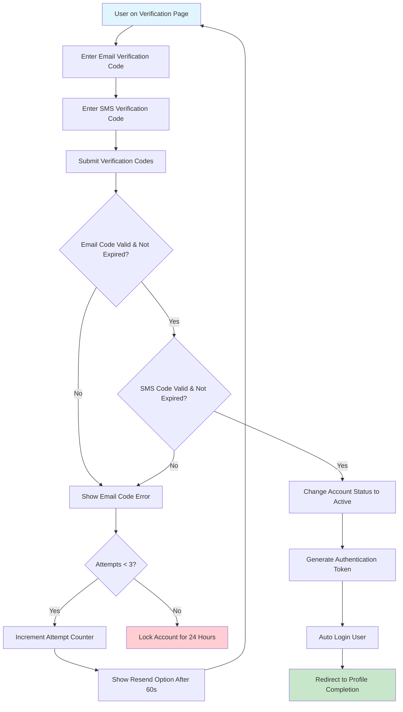

### AC-003: Profile Completion Flow

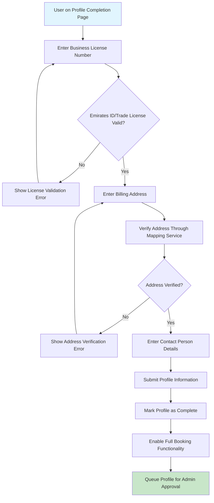

### AC-004: KYC Document Upload Flow

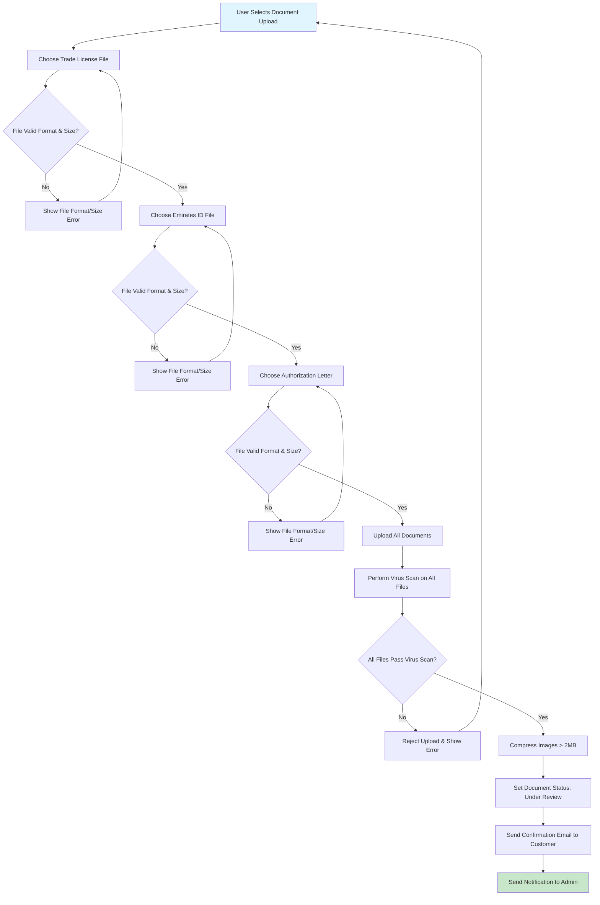

## CJ-002: Advanced Booking Request Creation

### AC-001: Basic Booking Information Flow

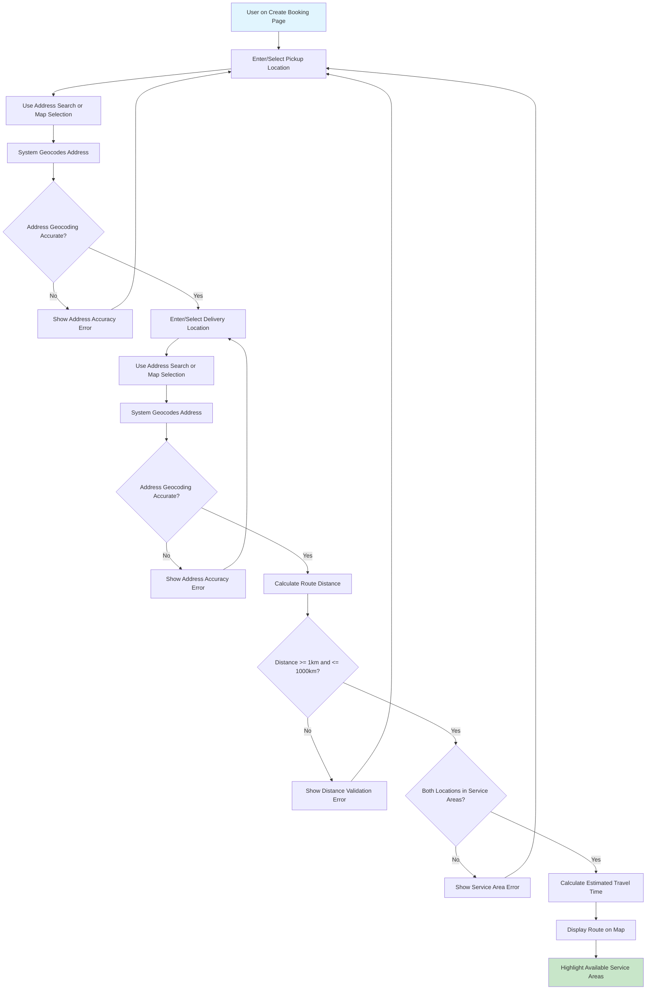

### AC-002: Cargo Specification Flow

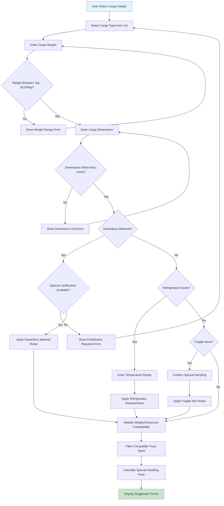

### AC-003: Scheduling and Timeline Flow

```mermaid
flowchart TD
    A[User Sets Pickup Schedule] --> B[Select Preferred Date]
    B --> C{Date >= Current Date + 2 Hours?}
    C -->|No| D[Show Minimum Advance Booking Error]
    D --> B
    C -->|Yes| E[Select Time Slot]
    E --> F[Check Driver/Truck Availability]
    F --> G{Availability Found?}
    G -->|No| H[Show Alternative Time Slots]
    H --> E
    G -->|Yes| I{Express Service Requested?}
    I -->|Yes| J[Apply 50% Express Surcharge]
    I -->|No| K{Weekend/Holiday Booking?}
    K -->|Yes| L[Apply 25% Weekend/Holiday Surcharge]
    K -->|No| M{Peak Hours (7-9 AM, 5-7 PM)?}
    M -->|Yes| N[Apply 15% Peak Hours Surcharge]
    M -->|No| O[Standard Pricing Applied]
    J --> P[Highlight Available Time Slots]
    L --> P
    N --> P
    O --> P
    P --> Q[Display Total Scheduling Cost]
    
    style A fill:#e1f5fe
    style Q fill:#c8e6c9
```

### AC-004: Special Instructions Flow

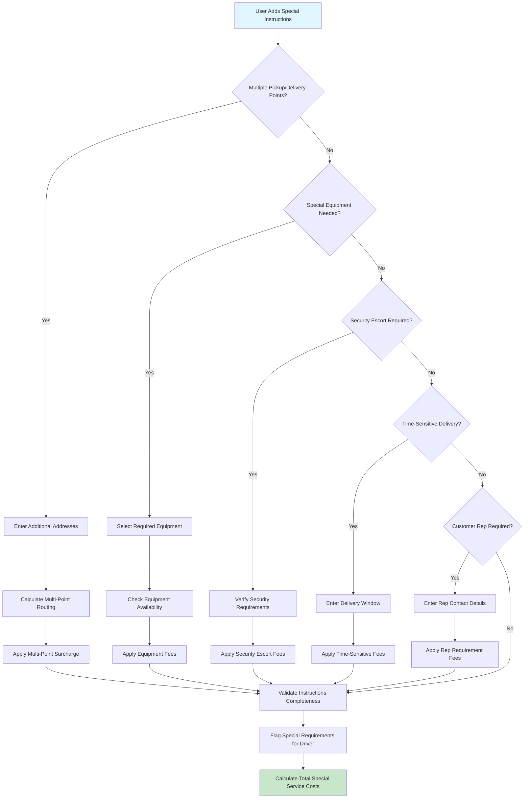

### AC-005: Real-time Quote Generation Flow

```mermaid
flowchart TD
    A[User Requests Quote] --> B[Calculate Base Rate by Truck Type]
    B --> C[Calculate Distance Charges per KM]
    C --> D[Calculate Weight Charges Above Base]
    D --> E[Apply Special Cargo Surcharge]
    E --> F[Apply Time-based Surcharge]
    F --> G[Apply Fuel Adjustment Factor]
    G --> H[Calculate Subtotal]
    H --> I[Apply Government Taxes (VAT)]
    I --> J[Generate Final Quote Amount]
    J --> K{Quote Generated Within 5 Seconds?}
    K -->|No| L[Show System Performance Error]
    K -->|Yes| M[Display Quote Breakdown]
    M --> N[Show All Cost Components]
    N --> O[Set Quote Validity: 24 Hours]
    O --> P[Store Quote for Customer Reference]
    
    style A fill:#e1f5fe
    style P fill:#c8e6c9
    style L fill:#ffcdd2
```

## CJ-003: Smart Truck Selection and Booking Confirmation

### AC-001: Available Truck Display Flow

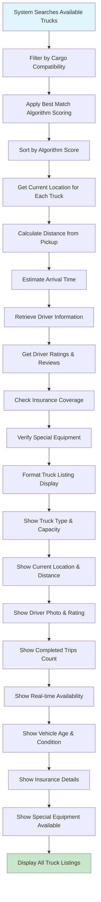

### AC-002: Truck Comparison Flow

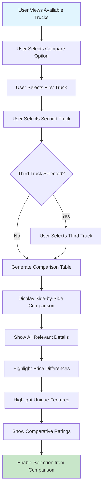

### AC-003: Driver Profile and Reviews Flow

```mermaid
flowchart TD
    A[User Views Specific Truck] --> B[Click Driver Details]
    B --> C[Load Driver Profile]
    C --> D[Display Driver Photo]
    D --> E[Show Overall Rating (1-5 Stars)]
    E --> F[Display Years of Experience]
    F --> G[Show Specialized Cargo Experience]
    G --> H[Display Language Proficiency]
    H --> I[Show Safety Record]
    I --> J[Display Customer Satisfaction Rating]
    J --> K[Show Recent Performance Trends]
    K --> L[Load Recent Customer Reviews]
    L --> M[Display Performance Metrics]
    M --> N[Show On-time Delivery Rate]
    N --> O[Show Damage Rate Statistics]
    O --> P[Display Driver Certifications]
    P --> Q[Show Experience Summary]
    Q --> R[Enable Driver Selection]
    
    style A fill:#e1f5fe
    style R fill:#c8e6c9
```

### AC-004: Booking Confirmation and Payment Flow

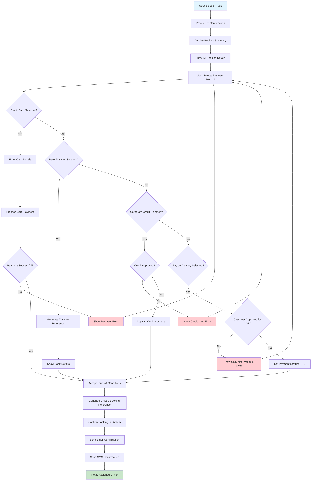

### AC-005: Booking Modification and Cancellation Flow

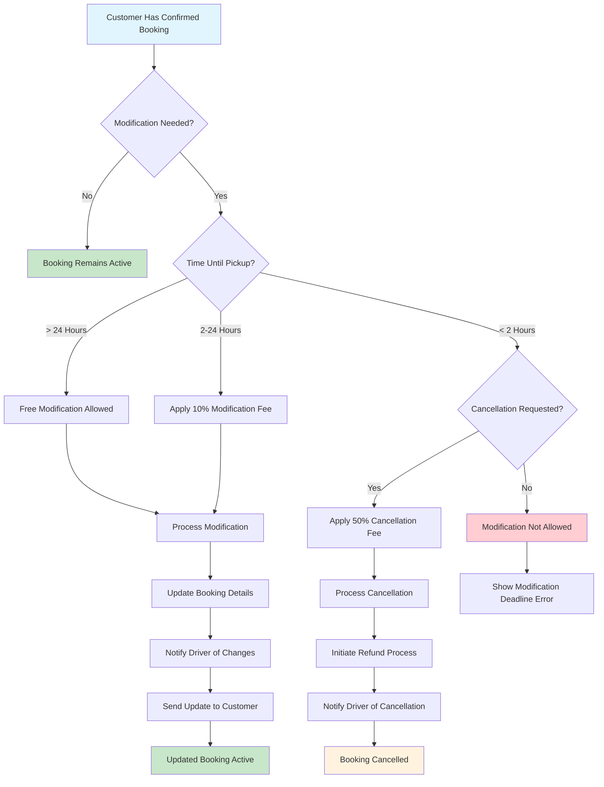

## CJ-004: Real-time Shipment Tracking

### AC-001: Live GPS Tracking Flow

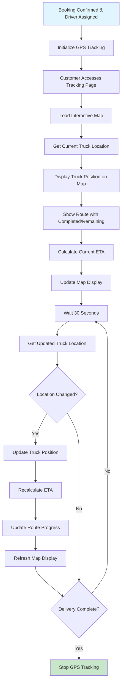

### AC-002: Delivery Status Updates Flow

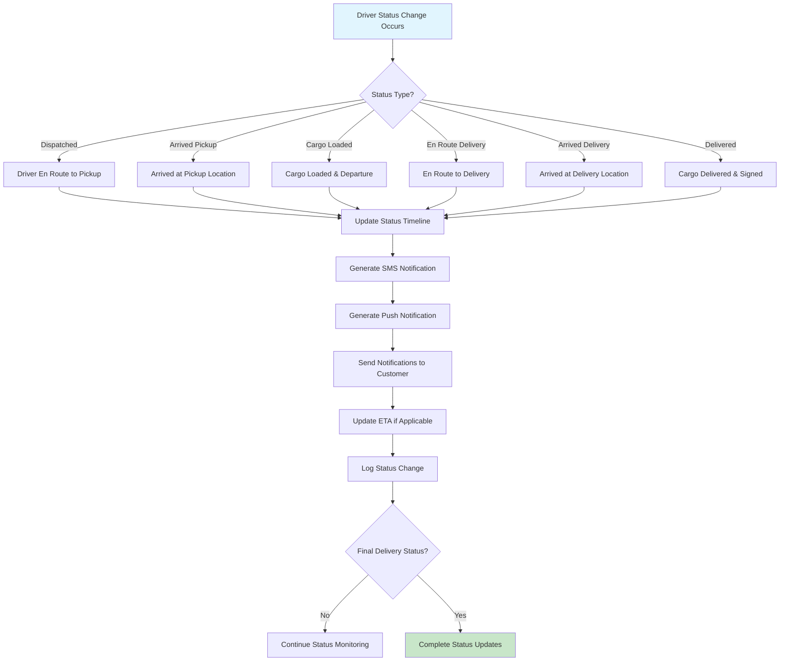

### AC-003: Communication with Driver Flow

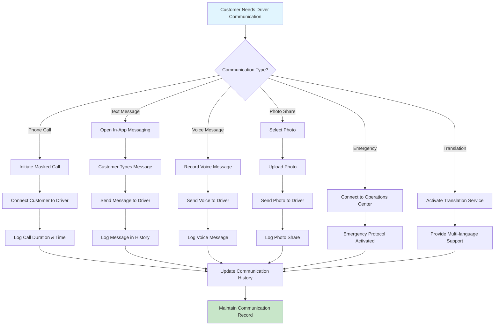

### AC-004: Delivery Proof and Documentation Flow

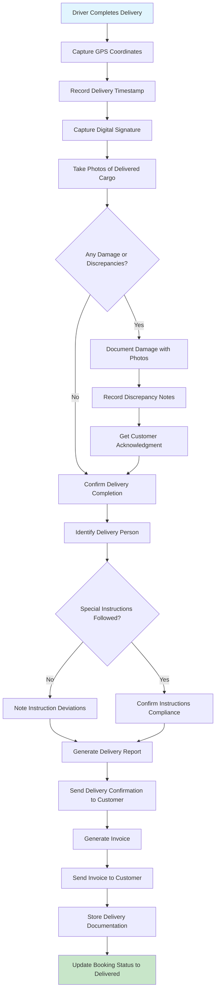

### AC-005: Delivery Analytics and Feedback Flow

```mermaid
flowchart TD
    A[Delivery Completed] --> B[Calculate Total Distance Traveled]
    B --> C[Compare with Planned Route]
    C --> D[Calculate Actual vs Estimated Time]
    D --> E[Analyze Route Efficiency]
    E --> F[Calculate Fuel Consumption]
    F --> G[Assess Driver Performance]
    G --> H[Compare Actual vs Quoted Costs]
    H --> I[Generate Analytics Report]
    I --> J[Present Trip Analytics to Customer]
    J --> K[Customer Reviews Trip Details]
    K --> L[Customer Rates Driver (1-5 Stars)]
    L --> M[Customer Rates Overall Service]
    M --> N[Customer Provides Written Feedback]
    N --> O[Customer Submits Feedback]
    O --> P[Store Feedback in Database]
    P --> Q[Update Driver Rating]
    Q --> R[Store Trip Data for Future Reference]
    R --> S[Enable Dispute Resolution Access]
    S --> T[Complete Customer Journey]
    
    style A fill:#e1f5fe
    style T fill:#c8e6c9
```

## Integration Points and Error Handling

### System Integration Flow

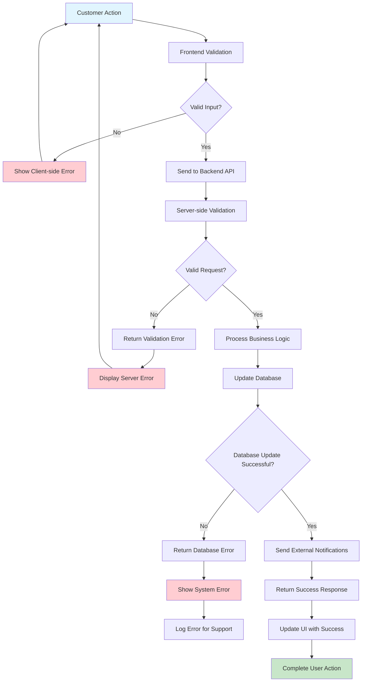

### Error Recovery Flow

```mermaid
flowchart TD
    A[System Error Occurs] --> B{Error Type?}
    B -->|Network Error| C[Show Network Error Message]
    C --> D[Provide Retry Option]
    D --> E[User Retries Action]
    B -->|Validation Error| F[Show Field-specific Error]
    F --> G[Highlight Invalid Fields]
    G --> H[User Corrects Input]
    B -->|Server Error| I[Show Generic Error Message]
    I --> J[Log Error Details]
    J --> K[Offer Contact Support]
    B -->|Timeout Error| L[Show Timeout Message]
    L --> M[Auto-retry with Exponential Backoff]
    M --> N{Retry Successful?}
    N -->|Yes| O[Continue Normal Flow]
    N -->|No| P[Show Persistent Error]
    P --> Q[Escalate to Support]
    E --> R{Action Successful?}
    R -->|Yes| O
    R -->|No| S[Show Retry Failed]
    S --> Q
    H --> T[Revalidate Input]
    T --> U{Validation Passed?}
    U -->|Yes| O
    U -->|No| F
    
    style A fill:#ffebee
    style O fill:#c8e6c9
    style Q fill:#fff3e0
```