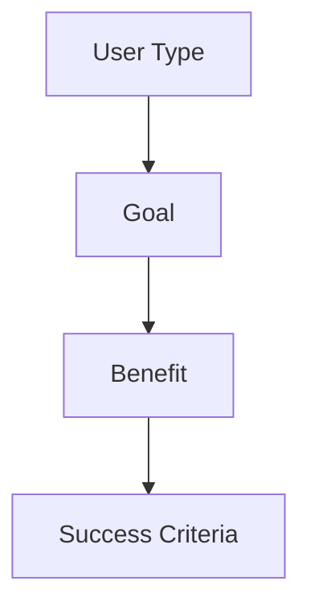
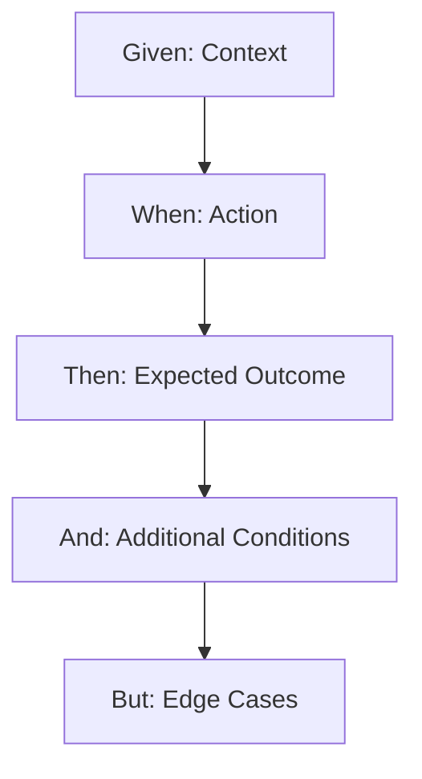
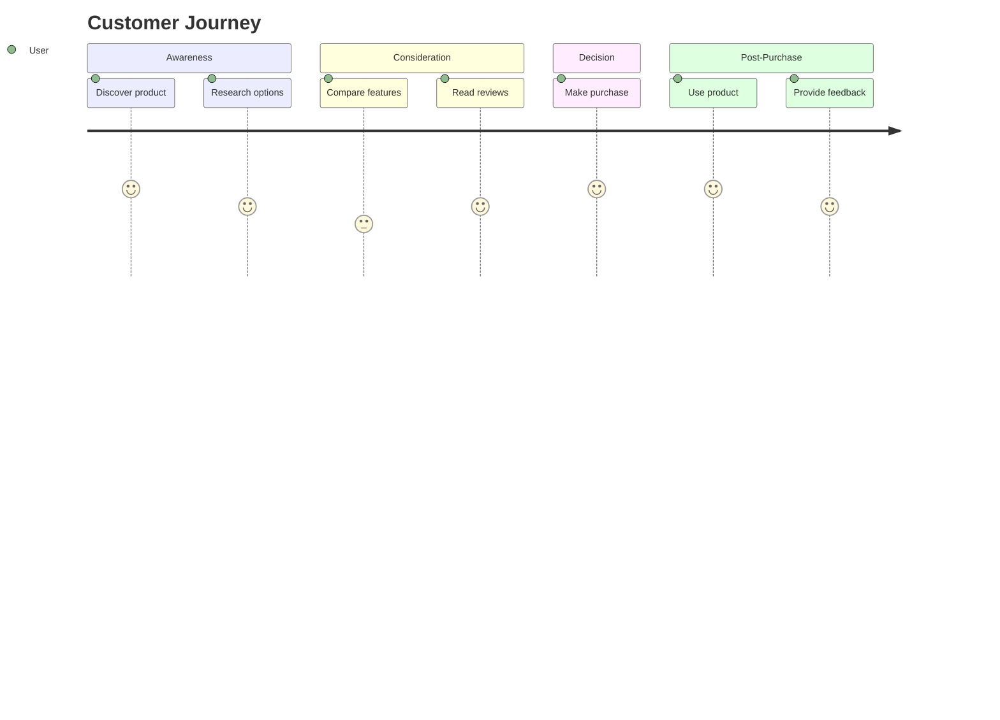
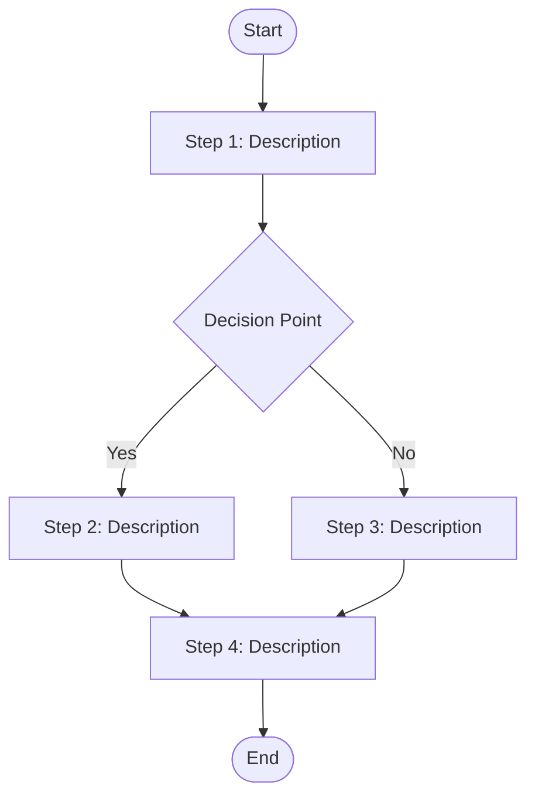

# User Story Diagram Framework

## Overview
This framework provides templates and guidelines for creating diagram flows from user stories in customer journey management.

## User Story Types and Their Diagram Patterns

### 1. Basic User Story Flow
**Pattern**: As a [user type], I want [goal] so that [benefit]

### 2. Acceptance Criteria Flow
**Pattern**: Given [context], When [action], Then [outcome]

### 3. Customer Journey Flow
**Pattern**: Multi-step journey with touchpoints and decision points

## Diagram Templates

### Template 1: Simple User Story Flow

### Template 2: Acceptance Criteria Flow

### Template 3: Customer Journey Flow

### Template 4: Process Flow with Steps

## How to Use This Framework

1. **Extract User Stories**: Copy the user stories from your PDF
2. **Identify Story Type**: Determine if it's a basic story, acceptance criteria, or journey
3. **Choose Template**: Select the appropriate Mermaid template
4. **Customize**: Replace placeholder text with actual content
5. **Create Diagram**: Use the Mermaid syntax to generate the diagram

## Common User Story Patterns

### E-commerce Customer Journey
- Product Discovery
- Comparison Shopping
- Purchase Decision
- Checkout Process
- Order Fulfillment
- Post-Purchase Support

### Service Management
- Service Request
- Triage and Assignment
- Service Delivery
- Quality Check
- Customer Feedback
- Follow-up

### Account Management
- Account Creation
- Profile Setup
- Service Selection
- Billing Management
- Support Requests
- Account Closure

## Next Steps

To proceed with creating your specific diagrams:

1. **Manual Extraction**: Open the PDF in a PDF viewer and copy the text content
2. **Paste Content**: Share the user stories with me
3. **Diagram Creation**: I'll create specific Mermaid diagrams for your content

Would you like me to help you with any specific part of this process?